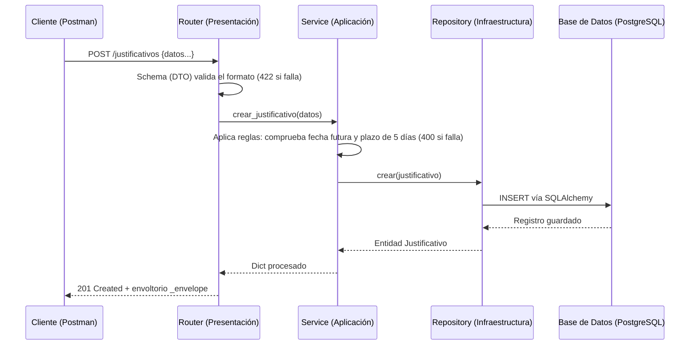
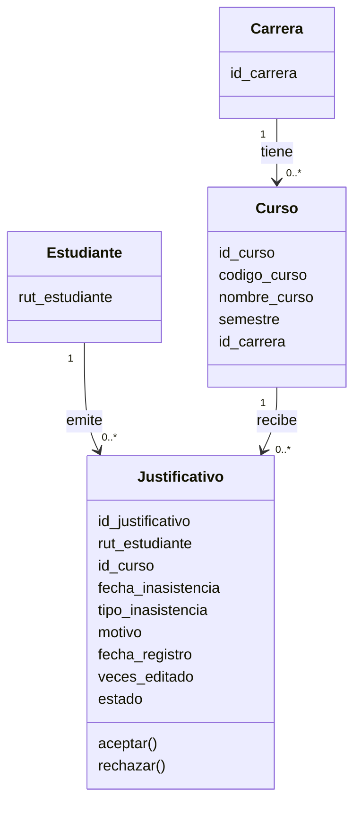
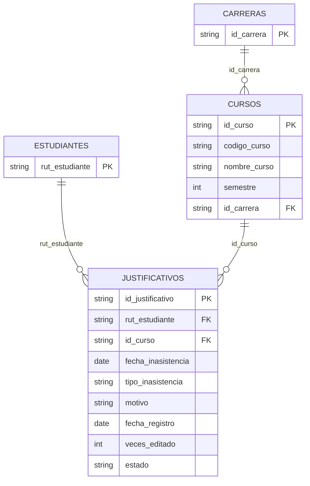

# Proyecto desarrollo de backend grupo 3

Backend desarrollado en Python, utilizando FastAPI, y Arquitectura: para la gestión de justificaciones a inasistencias estudiantiles.

integrantes y responsabilidades: 

Carlos Melendez / Dominio y datos: Diseño de Modelos de Dominio y generación de la base de datos simulada

Macarena Melin / API y lógica de negocio: Desarrollo de la capa de Enrutadores (Routers), exposición de Endpoints web y validación de peticiones HTTP.

Angel Obreque / Calidad y pruebas: Implementación de la capa de Servicios y Repositorios, Pruebas postman

Sofia Morales / Coordinación  y seguimiento + documentación e integración:  Arquitectura base, configuración global (`main.py`), manejador de errores estandarizado, documentación (README)

## Estructura del proyecto

*   `app/domain/`                 # Entidades y reglas del dominio
*   `app/repositories/`           # Acceso a datos (PostgreSQL/SQLAlchemy)
*   `app/infrastructure/`         # Modelos ORM, mappers y configuración BD
*   `app/routers/`                # Recibe solicitudes HTTP
*   `app/schemas/`                # DTO y validaciones Pydantic
*   `app/services/`               # Casos de uso y reglas de negocio
*   `app/main.py`                 # Crea y configura la aplicación
*   `tests_manual/`               # Colección Postman
*   `migrations/`                 # Versiones de la base de datos (Alembic)

### Instrucciones de Instalación y Ejecución

Para levantar este proyecto de manera local, lo primero a considerar es tener Python 3.10 o superior instalado

pasos:

1. **Clonar y ubicarse en repositorio:**
```bash
   git clone https://github.com/SofiNazaMorales/backend-2026-grupo-3
   cd backend-2026-grupo-3
```

2. **Crear y activar el entorno virtual (Obligatorio para aislar dependencias):**

   Para Linux o macOS:
```bash
   python3 -m venv venv
```
   Para Windows
```bash
    python -m venv venv
    venv\Scripts\activate.bat
```

3. **Instalar las dependencias del proyecto:**
```bash
    pip install -r requirements.txt
```

4. **Configuración de la Base de Datos (PostgreSQL):**
El proyecto requiere variables de entorno para conectarse a la base de datos sin exponer credenciales. Copia el archivo de ejemplo:
*En Linux/macOS:* `cp .env.example .env`
*En Windows:* `copy .env.example .env`
Abre el archivo `.env` recién creado y completa tus credenciales locales de PostgreSQL.

5. ** Ejecutar Migraciones (Alembic):**
Para generar la estructura oficial de las tablas en tu base de datos de PostgreSQL, ejecuta:
```bash
alembic upgrade head
```

6. **Cargar Datos Iniciales (Seeders):**
Para poblar la base de datos con los registros iniciales configurados por el equipo, ejecuta:
```bash
python run_seeder.py
```

7. **Levantar el servidor web (Uvicorn):**
```bash
   uvicorn app.main:app --reload
```
- Swagger (OpenAPI interactivo): <http://127.0.0.1:8000/docs>
- ReDoc: <http://127.0.0.1:8000/redoc>
- Especificación JSON: <http://127.0.0.1:8000/openapi.json>

**Si el puerto 8000 está ocupado** : cambia `PORT=8000` en tu `.env` y vuelve a ejecutar `docker compose up -d`; el `docker-compose.yml` usa ese mismo valor.

**Sin Docker:** instala PostgreSQL, crea el usuario y la base con los mismos valores del `.env` y salta el paso 3.

En Linux, sustituir la copia de PowerShell por:

```bash
test -f .env || cp .env.example .env

nano .env
```

Los comandos `uv`, `git` y `docker compose` de la secuencia son los mismos. Docker debe estar instalado y en ejecución.
La aplicación usa el puerto 8000; cambiar el puerto de PostgreSQL no cambia el de Swagger.


## Función de las capas (Arquitectura)

| Capa | Responsabilidad | Qué NO hace |
|---|---|---|
| **Routers (Presentación)** | Recibe HTTP, valida entrada con DTO Pydantic, llama al servicio y devuelve respuesta JSON. | No contiene lógica de negocio ni consultas a la BD. |
| **Services (Aplicación)** | Coordina los casos de uso, orquesta validaciones de tiempo/estado y aplica reglas de negocio. | No conoce HTTP ni SQL. |
| **Domain (Dominio)** | Entidades puras (dataclasses), enumeradores (enums) y reglas inherentes al dato. | No depende de FastAPI, SQLAlchemy ni de la BD. |
| **Infrastructure & Repositories** | Conexión, modelos ORM de SQLAlchemy, migraciones Alembic y manipulación de datos reales. | No decide reglas de negocio ni valida reglas lógicas. |

## Recorrido de una solicitud (Ejemplo: Crear Justificativo)



## Modelo de Datos

### Entidades (Dominio)


### Tablas (Infraestructura / PostgreSQL)


## Reglas de Negocio y Validaciones

| # | Regla / Validación | Respuesta | Ubicación en código |
|---|---|---|---|
| RN1 | **Plazo de evaluación:** Un justificativo por Evaluación no puede enviarse si pasaron más de 5 días hábiles. | 400 | `services/servicios.py` |
| RN2 | **Límite de ediciones:** Un justificativo no puede editarse más de 2 veces. | 400 | `services/servicios.py` |
| RN3 | **Restricción temporal:** La fecha de inasistencia no puede ser una fecha futura. | 422 | `domain/justificativo.py` |
| VAL1 | **Longitud mínima:** El motivo del justificativo debe tener al menos 10 caracteres. | 422 | `domain/justificativo.py` |
| VAL2 | **Rango numérico:** El semestre del curso debe estar entre 1 y 14. | 422 | `domain/curso.py` |
| VAL3 | **Tipos estrictos:** El tipo de inasistencia debe ser un valor válido del Enum (`EVALUACION` o `CLASE_REGULAR`). | 422 | `domain/enums.py` |

## Contrato REST (Endpoints)

Todas las respuestas exitosas devuelven 200/201. Los fallos devuelven 400 (Regla de negocio), 404 (No encontrado), 409 (Conflicto) o 422 (Validación).

| Método | URI | Descripción |
|---|---|---|
| POST | `/justificativos` | Crea un nuevo justificativo de inasistencia. |
| GET | `/justificativos` | Lista justificativos con soporte para filtros (id_curso, estado, tipo). |
| GET | `/justificativos/{id}` | Obtiene los detalles de un justificativo específico. |
| PUT | `/justificativos/{id}` | Edita un justificativo (suma al contador de ediciones). |
| DELETE | `/justificativos/{id}` | Elimina un justificativo del registro. |
| POST | `/cursos` | Registra un nuevo curso académico. |
| GET | `/cursos/{id}` | Obtiene información de un curso. |
| PUT | `/cursos/{id}` | Actualiza el nombre o semestre del curso. |
| POST | `/estudiantes` | Registra un estudiante en el sistema. |
| GET | `/estudiantes/{rut}` | Obtiene los datos de un estudiante por su RUT. |
| PUT | `/estudiantes/{rut}` | Actualiza datos del estudiante. |
| DELETE | `/estudiantes/{rut}` | Elimina un estudiante. |
| POST | `/facultades` | Crea una nueva facultad/carrera. |
| GET | `/facultades` | Lista las facultades registradas. |
| GET | `/facultades/{id}` | Obtiene detalles de una facultad. |
| DELETE | `/facultades/{id}` | Elimina una facultad del registro. |

### Contrato global

**1. Respuestas Exitosas (200, 201)**
Utilizan una estructura global de envoltorio (`_envelope`):

```json
{
  "success": true, 
  "data": { ... }, 
  "error": null,
  "message": "Operación realizada con éxito"
}
```

**2. Respuestas de Error (400, 404, 409, 422)**

```json
{
  "error": {
    "code": "string",
    "message": "string",
    "details": "array"
  }
}
```

### Acceso a documentación (OpenAPI/Swagger)
Una vez que el servidor esté corriendo con Uvicorn, la documentación interactiva (OpenAPI) generada automáticamente por FastAPI estará disponible en las siguientes rutas:

- **Swagger UI** (Recomendado para pruebas manuales): [http://localhost:8000/docs](http://localhost:8000/docs)
- **ReDoc** (Vista de documentación alternativa): [http://localhost:8000/redoc](http://localhost:8000/redoc)
- **Esquema OpenAPI JSON**: [http://localhost:8000/openapi.json](http://localhost:8000/openapi.json)

---

### Ejecución de Pruebas (Validación de Persistencia y Reglas)
El proyecto incluye un conjunto de 6 pruebas reproducibles para verificar CRUD, filtros, reglas de negocio y respuestas de error HTTP.

1. Localiza el archivo de colección exportado dentro de la carpeta `tests_manual/`.
2. Importa el archivo en tu cliente API de preferencia (Postman o Thunder Client).
3. Con el servidor corriendo localmente, ejecuta la colección completa. 
4. Los datos creados o modificados durante la prueba permanecerán en la base de datos PostgreSQL incluso tras reiniciar el servidor web, demostrando la persistencia.

