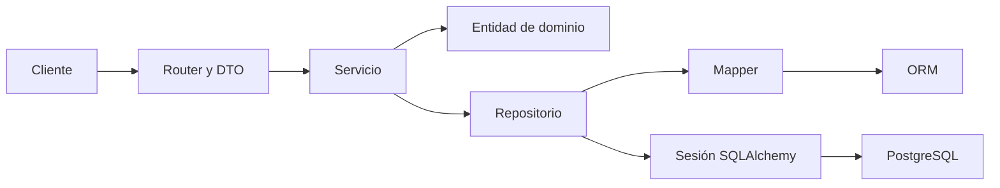

# API de justificativos de inasistencias - Grupo 3

API REST acumulativa de Backend I y II. Administra carreras, cursos, estudiantes
y justificativos con FastAPI, Pydantic, SQLAlchemy, PostgreSQL y Alembic.
No incluye frontend. Referencia de arquitectura: https://github.com/DrSolonius/backend_S4.

## Ejecutar desde una copia limpia (PowerShell, Python 3.10 o superior)

```powershell
git clone https://github.com/SofiNazaMorales/backend-2026-grupo-3
cd backend-2026-grupo-3
python -m venv .venv
.\.venv\Scripts\python.exe -m pip install -r requirements-dev.txt
if (!(Test-Path .env)) { Copy-Item .env.example .env }
notepad .env
```

En Linux/macOS: `python3 -m venv .venv`, `.venv/bin/python -m pip install -r requirements-dev.txt`
y `test -f .env || cp .env.example .env`. Usar `.venv/bin/python` en los comandos siguientes.
Para ejecución sin pytest/HTTPX basta instalar `requirements.txt`.

### PostgreSQL

Debe existir un servidor PostgreSQL en ejecución. Se conservan los valores que ya
usaba el proyecto: DB_USER=alumno, DB_NAME=clase, DB_HOST=localhost y DB_PORT=5432.
`.env.example` contiene un ejemplo de contraseña, no una credencial de producción.
Completar `.env` con los valores de la instalación existente; este archivo no se sube a Git.
No cambiar usuarios existentes ni recrear una base que contenga datos.

Si es una instalación nueva y todavía no existen el usuario y la base, un administrador
puede crearlos desde psql o pgAdmin (sustituir la contraseña de ejemplo):

```sql
CREATE USER alumno WITH PASSWORD 'CAMBIAR_POR_UNA_CLAVE_LOCAL';
CREATE DATABASE clase OWNER alumno;
```

Aplicar el esquema y cargar los ejemplos:

```powershell
.\.venv\Scripts\python.exe -m alembic upgrade head
.\.venv\Scripts\python.exe run_seeder.py
.\.venv\Scripts\python.exe run_api.py
```

La migración inicial está pensada para una base vacía. Si ya hay tablas de otra
versión, revisar primero el esquema y `alembic current`; no borrar tablas ni usar
`stamp head` sin comprobar compatibilidad. El seeder inserta faltantes por ID:
no cambia ni elimina usuarios, nombres, correos o registros existentes.
Incluye Roberto Díaz y María López con los mismos RUT y correos originales.
No existe un sistema de autenticación ni se agregaron cuentas de acceso nuevas.

### Puertos

API HTTP: **8000**. PostgreSQL: **5432**. Son servicios independientes.
`run_api.py` conserva 8000 por defecto; si está ocupado, reserva un puerto libre e
imprime la URL real de Swagger. No termina procesos ajenos ni cambia DB_PORT.

```powershell
.\.venv\Scripts\python.exe run_api.py --port 8001
```

Para desarrollo con recarga, elegir un puerto HTTP libre explícitamente:

```powershell
.\.venv\Scripts\python.exe -m uvicorn app.main:app --reload --port 8000
```

Con 8000: Swagger http://127.0.0.1:8000/docs, ReDoc http://127.0.0.1:8000/redoc,
OpenAPI http://127.0.0.1:8000/openapi.json. Si cambia el puerto, actualizar estas
URLs y `base_url` de Postman. Docker no es obligatorio y este repositorio no depende
de un archivo Compose para arrancar.

## Arquitectura y recorrido

Se usan agrupaciones equivalentes a la sección 5.6 del enunciado:

| Capa | Archivos | Responsabilidad |
|---|---|---|
| Presentación | app/routers, app/schemas, app/presentation | HTTP, DTO, documentación y dependencias |
| Aplicación | app/services | Casos de uso y reglas de aplicación |
| Dominio | app/domain | Entidades y reglas independientes de FastAPI y SQLAlchemy |
| Infraestructura | app/infrastructure | Sesiones, ORM, mappers, repositorios y seeders |
| Ensamblaje | app/main.py | Registro de rutas y traducción global de errores |
| Migraciones | migrations/versions | Evolución versionada de las tablas |



Ejemplo: POST /cursos valida CursoCreateDTO; la dependencia construye CursoService
con CursoRepository y una sesión por solicitud. El servicio comprueba duplicados
y construye Curso. El repositorio guarda el ORM, confirma, refresca y convierte al
dominio. La presentación devuelve JSON 201. Ante un fallo de escritura se revierte
la transacción; la sesión se cierra al terminar. No hay consultas SQL en routers.
Los módulos app/repositories son compatibilidad de imports antiguos; la implementación
activa está en app/infrastructure/repositories.

## Contrato REST

| Método | URI | Acción |
|---|---|---|
| POST | /justificativos | Crear |
| GET | /justificativos | Filtrar, ordenar y paginar |
| GET | /justificativos/{id_justificativo} | Obtener |
| PUT | /justificativos/{id_justificativo} | Actualizar y contar edición |
| DELETE | /justificativos/{id_justificativo} | Eliminar |
| POST | /cursos | Crear |
| GET | /cursos/{id_curso} | Obtener |
| PUT | /cursos/{id_curso} | Actualizar |
| POST | /estudiantes | Crear |
| GET | /estudiantes | Listar |
| GET | /estudiantes/{rut} | Obtener |
| PUT | /estudiantes/{rut} | Actualizar |
| DELETE | /estudiantes/{rut} | Eliminar |
| POST | /carreras | Crear |
| GET | /carreras | Listar |
| GET | /carreras/{id_carrera} | Obtener |
| GET | /facultades | Consultar catálogo fijo Enum |
| GET | /facultades/{codigo} | Obtener valor del catálogo |

18 operaciones de recursos, además de GET / para disponibilidad del proceso.
Carrera es la cuarta entidad persistente; Facultad es un catálogo fijo, no una quinta tabla.
No se afirma que exista CRUD de facultades ni que Facultad y Carrera sean lo mismo.

Éxitos 200/201 conservan el contrato global:

```json
{"success": true, "data": {}, "error": null, "message": "Operación realizada correctamente"}
```

DELETE correcto devuelve 204 sin cuerpo; un ID inexistente devuelve 404.
Los errores controlados usan:

```json
{"error": {"code": "NOT_FOUND", "message": "Recurso no encontrado", "details": []}}
```

400: regla de negocio. 404: recurso inexistente. 409: duplicado o restricción
referencial (relación inexistente o registro en uso). 422: esquema/validación.
OpenAPI incluye DTO de entrada/salida, ejemplos, parámetros y errores por operación.

### Consulta combinada

`GET /justificativos?id_curso=CRS-INF1108&estado=Pendiente&ordenar_por=fecha_inasistencia&direccion=desc&pagina=1&limite=20`

Filtra en SQL, cuenta el conjunto filtrado, ordena y luego pagina; usa el ID como
desempate estable. Direcciones asc/desc; página >=1; límite 1..100; orden validado.
Los metadatos se conservan dentro de `data`, respetando el envoltorio del grupo:

```json
{"success":true,"data":{"items":[],"total":0,"pagina":1,"limite":20,"total_paginas":0},"error":null,"message":"Justificativos obtenidos correctamente"}
```

## Reglas y validaciones

1. Máximo dos ediciones exitosas por justificativo; un intento rechazado no suma.
2. Una evaluación solo se justifica dentro de cinco días hábiles desde la inasistencia.
   Se excluye el día inicial y se cuentan lunes a viernes, sin calendario de feriados.
3. No se admiten inasistencias futuras; se comprueba también al actualizar.

El dominio también conserva la restricción de no aceptar un justificativo rechazado,
pero no se añadió un endpoint de transición de estado al contrato.

Validaciones comprobables: motivo 10..500 caracteres (longitud), semestre 1..14
(numérica), estado/tipo/facultad Enum (permitidos), email/fecha/RUT (formato), FK
a recursos existentes (existencia relacionada) y plazo/ediciones (negocio).
RUT se normaliza para consultar/crear sin cambiar los identificadores semilla;
la validación de formato actual no certifica el dígito verificador matemático.

## Modelo y diagramas

Cada entidad tiene identificador y al menos cuatro atributos útiles; ver
[diagramas](docs/modelo_y_alcance.md). La base impide referencias huérfanas.
Los borrados de estudiantes referenciados por justificativos se rechazan con 409.

## Pruebas reproducibles

```powershell
.\.venv\Scripts\python.exe -m pytest -q tests
.\.venv\Scripts\python.exe tests_manual/verificar_persistencia.py
```

pytest usa únicamente SQLite en memoria. La segunda prueba migra una SQLite
temporal, ejecuta dos veces el seeder y reinicia realmente Uvicorn conservando
la misma base de archivo. No modifica PostgreSQL ni certifica ese motor.

Para comprobar PostgreSQL con la configuración existente y un esquema temporal aislado:

```powershell
.\.venv\Scripts\python.exe tests_manual/verificar_persistencia.py --postgres
```

Requiere PostgreSQL disponible y permiso CREATE SCHEMA para el usuario configurado.
No cambia el usuario ni el puerto, no borra tablas existentes y elimina solamente
el esquema temporal creado por esta prueba. Ver [pruebas manuales](tests_manual/README.md).
Importar la colección Postman exportada y ajustar su base_url a la API que se pruebe.
Los resultados realmente ejecutados se registran en tests_manual y
[estado de cumplimiento](docs/cumplimiento_I_II.md).

## Responsabilidades y contribuciones

- Carlos Melendez: dominio y datos (entidades, modelos, migraciones y seeders).
- Macarena Melin: API y lógica de negocio (rutas, servicios e integración con repositorios).
- Ángel Obreque: calidad y pruebas (rama alexis/validacion-pruebas).
- Sofía Morales: coordinación, documentación e integración.

Se conservan los integrantes registrados en el README original.
Cada integrante debe acreditar cinco commits significativos, una rama diferente de
main y un PR. La implementación no fabrica ese historial ni publica cambios.

## Defensa

10 minutos de exposición/demostración y 5 de preguntas; máximo 15 diapositivas.
Una persona sorteada debe poder presentar todo. Mostrar dos operaciones exitosas,
un error y una consulta combinada; además, migración, seeder, pruebas y persistencia
tras reinicio. Decisiones y límites se documentan en docs/modelo_y_alcance.md.
