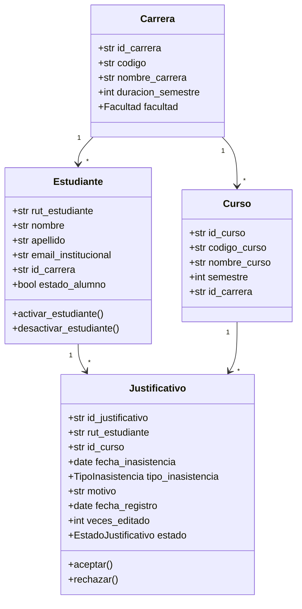
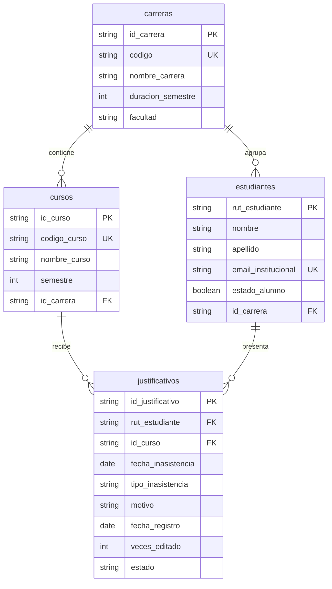

# Modelo, alcance y decisiones

## P1 a P7: propuesta para validar por el equipo

P1. Los avisos y antecedentes de inasistencias universitarias se reciben por medios
separados y su seguimiento puede depender de consultas manuales. Esta formulación
debe contrastarse con el levantamiento real del grupo; no representa una observación nueva.

P2. Estudiantes que presentan justificativos y personal académico que los consulta.
P3. Dificultad para localizar antecedentes y aplicar de manera consistente plazos
y límites de modificación.
P4. Carreras, cursos, estudiantes y justificativos, incluyendo fechas, motivos,
tipos, estados y contador de ediciones.

P5. El sistema debe permitir: (1) registrar estudiantes, (2) consultarlos por RUT,
(3) actualizar sus datos, (4) registrar cursos, (5) consultar cursos, (6) registrar
justificativos, (7) modificarlos respetando reglas, (8) eliminarlos, (9) consultar
su detalle, (10) filtrar/ordenar/paginar y (11) consultar carreras persistidas.

P6. Se excluyen frontend, autenticación/autorización y verificación documental
externa de certificados. No se agregó un servicio de correo ni carga de archivos.

P7. Aceptación verificable: crear y recuperar un justificativo; conservarlo tras
reinicio; rechazar una tercera edición; rechazar evaluaciones fuera de plazo;
rechazar datos inválidos; devolver una colección filtrada/ordenada/paginada con
totales correctos; rechazar referencias inexistentes.

## Diagrama de clases

## Diagrama de datos

## Decisiones para la defensa

- Separar DTO, dominio y ORM evita acoplar el contrato HTTP a las tablas.
- PostgreSQL permite persistencia e integridad referencial; ORM concentra el acceso.
- Migraciones versionadas permiten preparar una instalación vacía de forma repetible.
- Seeders idempotentes completan ejemplos sin reemplazar usuarios existentes.
- Rechazar borrados referenciados evita perder justificativos por cascadas accidentales.
- Filtrar/ordenar/paginar en SQL evita cargar toda la tabla para devolver una página.
- Rollback revierte escrituras pendientes fallidas; no deshace una transacción confirmada.
- El puerto HTTP se configura independientemente del de PostgreSQL; el iniciador
  reserva un puerto libre sin cerrar procesos ajenos.

Limitación: días hábiles se calculan sin feriados. Mejoras futuras: calendario
académico de feriados y autenticación/autorización por roles. La edición bloquea la fila con SELECT FOR UPDATE en PostgreSQL hasta confirmar
la escritura, para serializar el contador. SQLite no ofrece esa misma garantía de
bloqueo por fila; sus pruebas aisladas no certifican concurrencia PostgreSQL.
